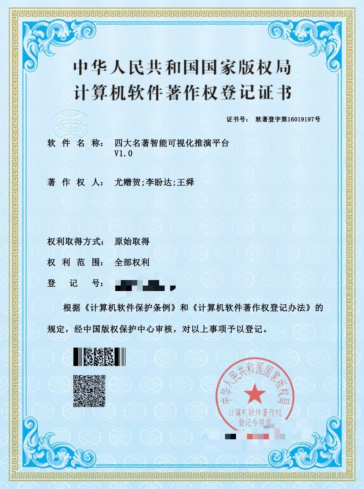
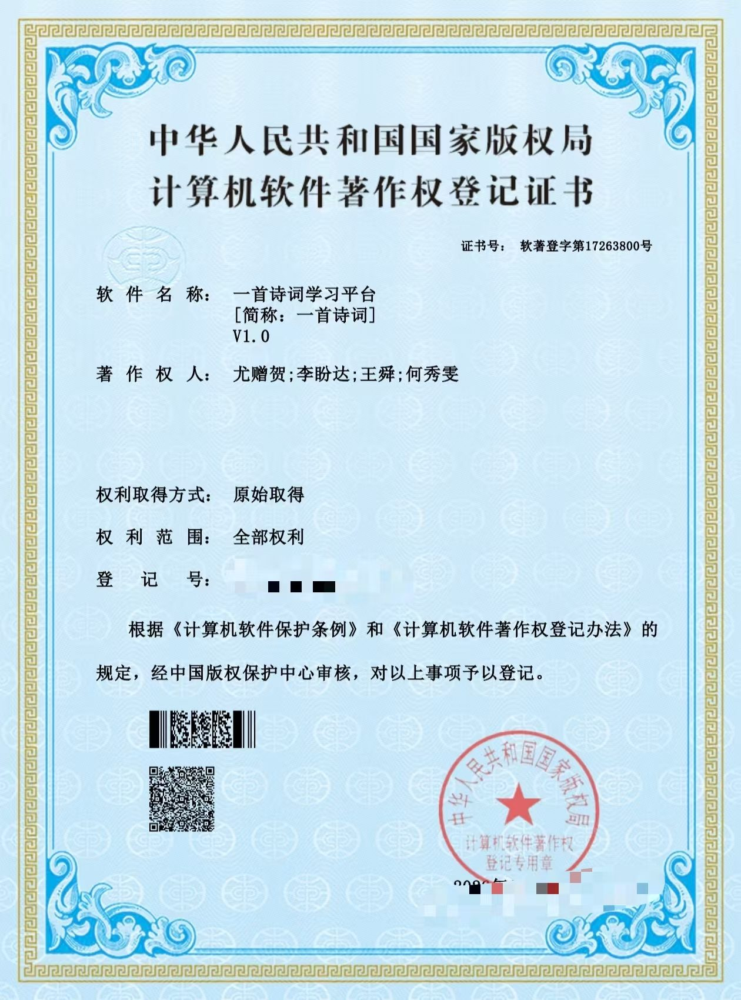

两本软著到手，先把图挂上来。

代码写完还不算完，申请的时候，项目说明、代码材料、说明书又得整理一遍。写代码还算熟，这些材料是真的磨人。

## 第一本：文智融典

文智融典是之前「四大名著」项目的迭代版，做的是名著知识图谱。人物关系、事件和图谱都能查。

前后端都是我写的，后端 Java + Spring Boot，图数据库 Neo4j，前端 Vue。

## 第二本：一首诗词

一首诗词也是自己从头搭的，用 Java 写的项目，这次也拿到了软著。
